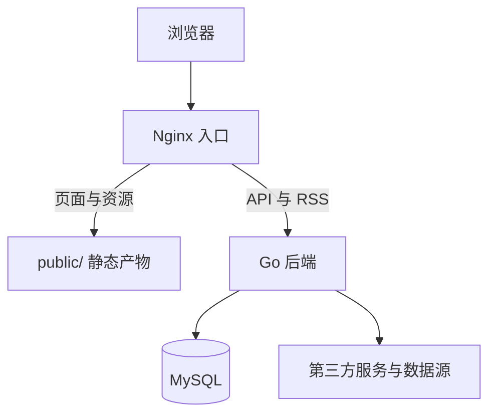
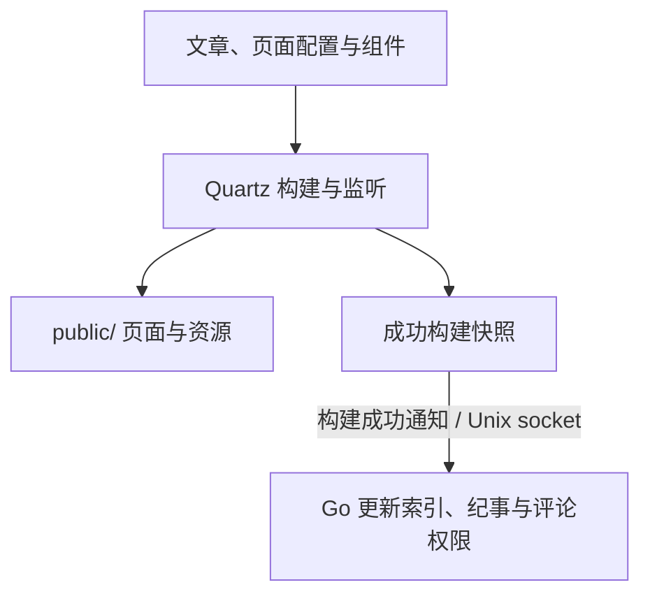

# 微光集

文章、文件分享、仓库与视频的统一入口。项目由 Quartz 静态构建、Go 常驻后端、MySQL 和 Nginx 组成，统一使用本目录的 Compose 部署。

本项目基于 [Quartz 4](https://github.com/jackyzha0/quartz) 二次开发。Quartz 是将 Markdown 笔记发布为网站的静态站点生成器，本项目沿用其内容处理、插件与静态构建能力，并扩展了页面组件、构建与热更新流程，以及 Go 后端提供的认证、文件分享、媒体播放和第三方服务接入。

Quartz 相关资源：

- [上游源码](https://github.com/jackyzha0/quartz)
- [官方网站与使用文档](https://quartz.jzhao.xyz/)
- [上游 MIT 许可证](quartz/LICENSE.txt)，保留于本项目的 Quartz 工程中。

本项目新增代码采用 [MIT 许可证](LICENSE)。Quartz 及其他第三方代码、依赖与资源保留各自的版权声明和许可证。

## 部署

```sh
cd /home/goblincwl/docker/quartz4
# 首次部署：复制后填写数据库密码，MYSQL_PASSWORD 至少 24 个字符。
cp -n .env.example .env
docker compose up -d --build
```

数据库密码从根目录 `.env` 读取，该文件不提交到 Git。使用已有数据库时填写原密码；仅修改 `.env` 不会更改数据库内的密码。

## 文档入口

| 要了解或维护什么 | 唯一维护位置 |
| --- | --- |
| 模块职责、访问链路与数据来源 | [整体架构](#整体架构) |
| 配置、部署、权限、更新触发、备份与故障处理 | [服务规则](architecture/service-rules.md) |
| 表结构、字段、约束及初始化 | [库表设计](architecture/database.md) |
| 请求缓存与页面生命周期 | [缓存约定](architecture/cache.md) |
| 页面、组件、静态构建 | [Quartz 工程](quartz/README.md) |
| API、同步任务、数据与媒体适配 | [Go 后端工程](quartz-server/README.md) |

整体架构在本 README 维护，服务、库表与缓存规则在 `architecture/` 维护；工程 README 负责代码入口，模块说明负责局部实现。Quartz 原始参考资料位于 `quartz/docs/`，不作为本站部署与接口规范。

修改前确认所属模块，修改后运行对应有效测试及构建。浏览器体验由维护者验证，未经明确要求不执行浏览器测试。

## 整体架构

本节维护实际部署架构和服务边界；接口、存储、调度或部署关系变化时同步更新。初始化表结构见 [初始化 SQL](quartz-server/database/init.sql)，不含业务数据。

## 访问链路

访问时，静态页面由 Nginx 提供；本站业务由 Go 处理。



图中的 Nginx 入口包含外层 `nginx-proxy` 和站点 `quartz-nginx`。文件域和媒体域的本站接口可由外层直接转发 Go。OpenList、Jellyfin/Fontinass、Artalk 等原生入口，以及 Bilibili 官方播放器，保留各自的访问链路，不强制经过本站业务后端。

## 构建与热更新

Quartz 持续监听源文件；成功构建后，页面产物交给 Nginx；私有快照通过 Unix socket 发布通知交给 Go。



Quartz 容器内由主进程管理编译与源码监听，由一份受控子进程执行构建及文章热更新。完整重载会释放旧子进程，避免历史构建模块和原生缓存长期堆积；文章增量更新复用当前子进程。两者通过私有 IPC 共用发布锁，不增加独立业务服务。

管理员重载沿相反方向发起：**Go → Unix socket → Quartz**。宿主观察器只负责把容器事件写入私有快照，再由 Go 记录运行纪事。具体文件与协议见 [服务规则](architecture/service-rules.md)。

## 模块分工

| 模块 | 负责内容 | 数据来源或存储 |
| --- | --- | --- |
| Quartz | 页面、浏览器组件、静态构建、文件监听 | Obsidian 与源码 → `public/` 和成功快照 |
| Go | API、认证、配置、索引、统计、同步、媒体授权代理 | MySQL、私有快照、第三方接口；文章标签写回笔记，其余本机来源只读 |
| MySQL | 本站业务记录、统一索引、配置与平台缓存 | `quartz-server_mysql-data` 卷 |
| Nginx | HTTPS、域名分发、静态文件及连接层代理 | 根站点配置与外层域名配置 |

## 第三方来源

| 用途 | 来源 | 接入方式 |
| --- | --- | --- |
| 文件与分享 | OpenList | API 与必要的只读数据库查询 |
| 媒体播放 | Jellyfin、Fontinass | API、只读媒体目录查询、受限资源代理 |
| 仓库与版本 | Gitea、GitHub | Gitea API 和现有 Git 存储；GitHub 提供镜像来源、Release 和用户活动 |
| 视频 | Bilibili | 后台同步资料；浏览器使用官方播放器 |
| 评论 | Artalk | 原生评论组件，Go 提供归档和权限同步 |
| 状态与活动 | Beszel、ActivityWatch、AstrBot、NapCat | 实时指标、API 和必要的只读数据 |
| 日历 | 私有日记 | 仅提取限定统计标记 |
| 一言 | 公开一言 API | Go 合并请求并共享缓存 |

## 部署目录

```text
quartz4/
├── README.md                    项目入口与整体架构
├── architecture/                服务规则、库表设计与缓存约定
├── .env                        本地数据库密码（不提交）
├── .env.example                环境变量示例
├── docker-compose.yml          统一启动 Quartz、Go、MySQL、Nginx、Artalk
├── nginx.conf                  站点静态资源与 Go API 路由
├── quartz/                     页面、组件、构建与热更新代码
├── quartz-server/
│   ├── cmd/                    服务、管理、观察器入口
│   ├── internal/               业务与第三方适配
│   └── database/init.sql       当前库表初始化 SQL
├── public/                     版本化构建产物（current → 当前版本）
├── runtime/
│   ├── chronicle/              私有快照、发布规则、重载 socket
│   ├── events/                 Go 接收构建成功通知的私有 socket
│   ├── server/auth/            后端加密与身份密钥
│   ├── errors/                 静态错误页配置与产物
│   └── backups/                迁移与恢复备份
└── artalk-data/                Artalk 自身数据
```

外层 Nginx 配置位于 `/home/goblincwl/docker/nginx-proxy/nginx.conf`。MySQL 实际数据位于 Docker 命名卷 `quartz-server_mysql-data`，不在 `quartz-server/` 源码目录内。

第三方服务保留自身数据的管理权：Go 对 OpenList、Jellyfin、Beszel 的必要本机数据库查询采用只读挂载，对 Gitea 使用其现有仓库存储；第三方写入仍通过各自 API 完成。
