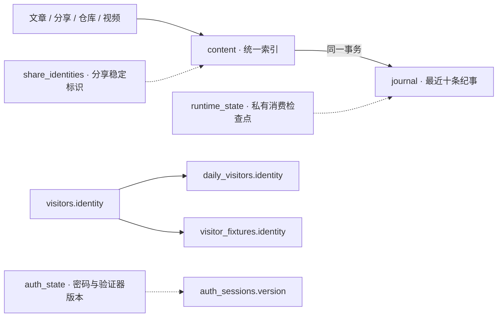

# 本站库表设计

数据库：`quartz`；MySQL 8.4；共 28 张表。

本文描述本站 MySQL，不包含 OpenList、Jellyfin、Beszel、Gitea、Artalk 自有库。字段、默认值、索引和约束从已应用结构生成；不读取或导出业务行、账号密码、Token、Cookie 或密钥。完整建表语句见 [初始化 SQL](../quartz-server/database/init.sql)。

## 设计约定

- InnoDB、utf8mb4；表级排序规则见下方明细。多数业务时间沿用来源的 ISO 8601 字符串，以保持现有接口契约；认证过期时间使用 Unix 毫秒。日访客按 Asia/Shanghai 归日。
- 明确的结构化字段使用原生 JSON，由数据库验证语法；混合纯文本值的 video_meta、content_meta、runtime_state 等继续保留文本类型，按键解释。JSON 不等于业务结构校验，应用仍检查具体字段。
- daily_visitors、visitor_fixtures 对 visitors 有物理外键，删除父访客自动级联删除这两类记录。内容及认证版本关联仍由应用维护，不应把逻辑关联图全部视为物理外键。日常业务变更优先通过星枢数据管理。
- 四源索引只收录各类项目入口；分享子目录及管理员空间不单独入索引。最终标签统一查询 content.tags；文章只从 Markdown 热更新快照同步，编辑标签写回原始文件，不使用 extra.tagsManaged。非文章的 extra.tagsManaged 表示人工维护，extra.sourceTags 用于恢复来源标签。
- 文章的 `content.extra.filePath` 保存原始相对路径，用于恢复含空格等字符的目录名，也是管理员标签操作写回 Markdown 的唯一文件定位；公开 API 的 `slug`/`href` 继续作为规范路由，不能用原始文件名替换跳转地址。
- 索引和内容纪事在同一个 MySQL 事务提交，journal 只保留最近十条；不再维护待消费事件表。构建、服务恢复的去重检查点另存 runtime_state。
- alerts 只供管理员查询；连续同类异常按十分钟静默间隔合并，新增事件时裁剪最近1000条，不设清理周期任务。告警写入由既有请求、任务及观察器异常触发，队列或数据库故障回退进程日志。
- 平台凭据以加密信封保存，TOTP 密钥也以加密形式保存；相关加密密钥和访客身份密钥位于私有文件。`settings` 仍可能包含内部服务地址或私密配置，不能公开整表。
- geoip_datasets 保存压缩的 IPv4/IPv6 XDB 参考库，启动校验并载入内存；星历按月拆分 adapter_snapshots，公开 API 只读取指定月份。
- 数据库备份必须同时保留 `runtime/server/auth/` 和部署密钥；只备份库不足以恢复加密凭据及原有身份。

## 逻辑关联

下图中访客与每日记录、测试标记之间的实线是数据库外键，其余虚线为应用层关联。



## 表目录

| 模块 | 表 | 用途 |
| --- | --- | --- |
| 内容发现 | [`content`](#content) | 文章、分享首页、仓库和视频的服务器统一内容索引 |
| 内容发现 | [`content_meta`](#content_meta) | 统一内容索引与RSS订阅的版本及更新时间元数据 |
| 内容发现 | [`content_sources`](#content_sources) | 各类内容来源最近一次成功索引检查时间 |
| 内容发现 | [`share_identities`](#share_identities) | OpenList分享来源与本站稳定内容标识的映射 |
| 友链与反馈 | [`friends`](#friends) | 友链资料、固定编号及审核状态 |
| 友链与反馈 | [`friend_jobs`](#friend_jobs) | 友链头像、RSS 和自动审核持久化队列 |
| 友链与反馈 | [`feedback`](#feedback) | 访客问题反馈、联系邮箱、浏览器信息及处理状态 |
| 访客统计 | [`visitors`](#visitors) | 彗星来访者身份、首次及最近访问、地区与浏览器信息 |
| 访客统计 | [`daily_visitors`](#daily_visitors) | 按日期和访客身份去重的每日来访明细 |
| 访客统计 | [`visitor_fixtures`](#visitor_fixtures) | 访客测试数据的身份及批次标记 |
| 访客统计 | [`geoip_datasets`](#geoip_datasets) | IPv4 å’Œ IPv6 地理归属地参考数据，启动加载内存用于本地查询 |
| 视频与仓库缓存 | [`videos`](#videos) | Bilibili视频基础资料、简介、发布时间及播放弹幕统计缓存 |
| 视频与仓库缓存 | [`video_meta`](#video_meta) | Bilibili系列、分集、详情、用户动态及同步控制元数据 |
| 视频与仓库缓存 | [`video_assets`](#video_assets) | Bilibili头像和封面等本地图片缓存及来源版本信息 |
| 视频与仓库缓存 | [`repo_snapshots`](#repo_snapshots) | GitHub用户资料、活动及仓库相关公开快照缓存 |
| 视频与仓库缓存 | [`repo_avatar`](#repo_avatar) | 仓库平台用户头像的本地二进制缓存及来源版本信息 |
| 视频与仓库缓存 | [`adapter_snapshots`](#adapter_snapshots) | 首页等公开适配数据的持久化快照及更新时间 |
| 认证与配置 | [`settings`](#settings) | 站点模块配置及内部服务接入设置，仅通过授权接口管理 |
| 认证与配置 | [`auth_state`](#auth_state) | 管理员密码校验参数、TOTP绑定、恢复码及认证版本状态 |
| 认证与配置 | [`auth_sessions`](#auth_sessions) | 管理员登录会话令牌摘要、认证版本及过期时间 |
| 认证与配置 | [`auth_attempts`](#auth_attempts) | 管理员认证失败次数及限流过期状态 |
| 认证与配置 | [`provider_credentials`](#provider_credentials) | 平台访问凭据的加密信封、检查状态及最近检查时间 |
| 认证与配置 | [`service_credentials`](#service_credentials) | 服务状态检测专用认证，与平台接入凭据独立 |
| 运行状态 | [`monitored_services`](#monitored_services) | 可增删、启停和排序的公开服务状态列表 |
| 运行状态 | [`alerts`](#alerts) | 本站告警记录；连续同类异常合并，事件写入时保留最近1000条 |
| 运行状态 | [`journal`](#journal) | 运行纪事，保留最近十条内容更新、站点更新及服务恢复事件 |
| 运行状态 | [`runtime_state`](#runtime_state) | 私有运行检查点，包括构建基线、容器事件及评论权限同步状态 |
| 运行状态 | [`resource_locks`](#resource_locks) | 业务资源事务锁标记，用于串行化排序与索引等并发写入 |

## 内容发现

<a id="content"></a>

### content

文章、分享首页、仓库和视频的服务器统一内容索引。

引擎：`InnoDB`；排序规则：`utf8mb4_bin`。

| 字段 | 类型 | 可空 | 默认值 / 自动值 | 含义 |
| --- | --- | --- | --- | --- |
| `id` | `varchar(191)` | 否 | — | 本站内容稳定标识，也是标签调整关联标识 |
| `type` | `varchar(16)` | 否 | — | article / share / repo / video |
| `source_id` | `varchar(700)` | 否 | — | 内容来源系统中的标识，结合 type 唯一 |
| `slug` | `varchar(768)` | 否 | — | 本站内容路径标识，唯一 |
| `href` | `text` | 否 | — | 本站跳转地址 |
| `title` | `text` | 否 | — | 显示标题 |
| `content` | `longtext` | 否 | — | 可公开索引的正文；加密内容不保留未授权正文 |
| `description` | `longtext` | 否 | — | 内容摘要；加密内容不保留未授权摘要 |
| `tags` | `json` | 否 | — | 项目最终标签列表 JSON，由来源同步或管理员直接维护 |
| `links` | `json` | 否 | — | 站内关联链接列表 JSON |
| `published_at` | `varchar(40)` | 是 | NULL | 创建、发布或分享时间 |
| `updated_at` | `varchar(40)` | 是 | NULL | 内容更新时间 |
| `encrypted` | `tinyint unsigned` | 否 | — | 加密标记，0/1 |
| `revision` | `text` | 否 | — | 内容语义版本摘要，用于识别索引变化 |
| `event_revision` | `text` | 否 | — | 变化事件版本，用于避免缓存刷新产生重复纪事 |
| `search_text` | `longtext` | 否 | — | 供本站搜索使用的规范化文本 |
| `extra` | `json` | 否 | — | 类型特有附加信息 JSON |

索引与约束：

- 普通索引 `content_dates`：`updated_at` DESC, `id`。
- 唯一索引 `content_source`：`type`, `source_id`。
- 主键 `PRIMARY`：`id`。
- 唯一索引 `slug`：`slug`。
- CHECK `content_encrypted`：``((`encrypted` in (0,1)))``。
- CHECK `content_type`：``((`type` in (_utf8mb4'article',_utf8mb4'share',_utf8mb4'repo',_utf8mb4'video')))``。

<a id="content_meta"></a>

### content_meta

统一内容索引与RSS订阅的版本及更新时间元数据。

引擎：`InnoDB`；排序规则：`utf8mb4_bin`。

| 字段 | 类型 | 可空 | 默认值 / 自动值 | 含义 |
| --- | --- | --- | --- | --- |
| `key` | `varchar(191)` | 否 | — | 元数据名称，如 feed_hash、feed_updated |
| `value` | `longtext` | 否 | — | 对应索引/订阅元数据值 |

索引与约束：

- 主键 `PRIMARY`：`key`。

<a id="content_sources"></a>

### content_sources

各类内容来源最近一次成功索引检查时间。

引擎：`InnoDB`；排序规则：`utf8mb4_bin`。

| 字段 | 类型 | 可空 | 默认值 / 自动值 | 含义 |
| --- | --- | --- | --- | --- |
| `type` | `varchar(16)` | 否 | — | 来源类型 |
| `checked_at` | `varchar(40)` | 否 | — | 来源首次初始化或实际更新索引的时间；无变化不改写 |

索引与约束：

- 主键 `PRIMARY`：`type`。

<a id="share_identities"></a>

### share_identities

OpenList分享来源与本站稳定内容标识的映射。

引擎：`InnoDB`；排序规则：`utf8mb4_bin`。

| 字段 | 类型 | 可空 | 默认值 / 自动值 | 含义 |
| --- | --- | --- | --- | --- |
| `source_id` | `varchar(700)` | 否 | — | OpenList 分享来源标识 |
| `uid` | `varchar(191)` | 否 | — | 本站分配的稳定分享标识，唯一 |

索引与约束：

- 主键 `PRIMARY`：`source_id`。
- 唯一索引 `uid`：`uid`。

## 友链与反馈

<a id="friends"></a>

### friends

友链资料、固定编号及审核状态。

引擎：`InnoDB`；排序规则：`utf8mb4_bin`。

| 字段 | 类型 | 可空 | 默认值 / 自动值 | 含义 |
| --- | --- | --- | --- | --- |
| `id` | `varchar(80)` | 否 | — | 友链唯一标识 |
| `number` | `int unsigned` | 否 | auto_increment | 友链固定编号，用于卡片编号，不随 RSS 排序变化 |
| `name` | `text` | 否 | — | 网站名称 |
| `url` | `varchar(1500)` | 否 | — | 网站 HTTPS 地址 |
| `backlink_url` | `varchar(1500)` | 否 | `` | 包含本站友链的页面 HTTPS 地址 |
| `rss_url` | `varchar(1500)` | 否 | `` | RSS 订阅地址，选填 HTTP 或 HTTPS 链接 |
| `avatar` | `text` | 否 | — | 网站头像 HTTPS 地址 |
| `avatar_source` | `varchar(1500)` | 否 | `` | 原始头像 HTTP 或 HTTPS 地址，空值不参与每日刷新 |
| `latest_update` | `varchar(32)` | 否 | `` | RSS 最新文章时间，UTC ISO 8601，空值表示未知 |
| `description` | `text` | 否 | — | 网站简介 |
| `example` | `tinyint unsigned` | 否 | — | 示例数据标记，保留旧数据契约 |
| `status` | `varchar(16)` | 否 | `展示中` | 展示中 / 待审核 / 已失效 |
| `review_result` | `varchar(255)` | 否 | `` | 最近一次友链审核结果说明 |
| `review_checked_at` | `varchar(32)` | 否 | `` | 最近一次友链审核时间，UTC ISO 8601 |
| `health_failures` | `tinyint unsigned` | 否 | `0` | 首页连续失败天数，0 为正常，7 次后停止重试 |
| `health_checked_on` | `varchar(10)` | 否 | `` | 最近首页检查日期，北京时间 YYYY-MM-DD，同日不重复计数 |
| `health_error` | `varchar(255)` | 否 | `` | 最近首页检查失败原因 |
| `url_hash` | `binary(32)` | 是 | 生成列：``unhex(sha2(`url`,256))`` | URL 的 SHA-256 二进制生成列，用于唯一约束 |

索引与约束：

- 唯一索引 `friends_number`：`number`。
- 普通索引 `friends_updated`：`latest_update`, `number`。
- 唯一索引 `friends_url_hash`：`url_hash`。
- 主键 `PRIMARY`：`id`。
- CHECK `friends_example`：``((`example` in (0,1)))``。
- CHECK `friends_status`：``((`status` in (_utf8mb4'展示中',_utf8mb4'待审核',_utf8mb4'已失效')))``。

<a id="friend_jobs"></a>

### friend_jobs

友链头像、RSS 和自动审核持久化队列。

引擎：`InnoDB`；排序规则：`utf8mb4_bin`。

| 字段 | 类型 | 可空 | 默认值 / 自动值 | 含义 |
| --- | --- | --- | --- | --- |
| `friend_id` | `varchar(80)` | 否 | — | 待处理友链标识 |
| `generation` | `bigint unsigned` | 否 | `1` | 任务版本，重复提交递增以保护新任务 |
| `state` | `varchar(16)` | 否 | `pending` | pending / running |
| `attempts` | `int unsigned` | 否 | `0` | 后台处理失败次数 |
| `available_at` | `bigint` | 否 | `0` | 下次可处理的 Unix 毫秒时间，0 表示立即 |
| `last_error` | `varchar(1000)` | 否 | `` | 最近处理失败原因 |
| `enqueued_at` | `varchar(32)` | 否 | `` | 任务提交时间，UTC ISO 8601 |

索引与约束：

- 普通索引 `friend_jobs_ready`：`state`, `available_at`, `enqueued_at`。
- 主键 `PRIMARY`：`friend_id`。
- CHECK `friend_jobs_state`：``((`state` in (_utf8mb4'pending',_utf8mb4'running')))``。
- 外键 `friend_jobs_friend`：`friend_id` → `friends.id`；删除 CASCADE，更新 NO ACTION。

<a id="feedback"></a>

### feedback

访客问题反馈、联系邮箱、浏览器信息及处理状态。

引擎：`InnoDB`；排序规则：`utf8mb4_bin`。

| 字段 | 类型 | 可空 | 默认值 / 自动值 | 含义 |
| --- | --- | --- | --- | --- |
| `id` | `varchar(80)` | 否 | — | 反馈唯一标识 |
| `email` | `text` | 否 | — | 联系邮箱 |
| `browser` | `text` | 否 | — | 浏览器识别描述 |
| `user_agent` | `text` | 否 | — | 原始 User-Agent |
| `description` | `text` | 否 | — | 问题描述 |
| `status` | `varchar(16)` | 否 | `待处理` | 待处理 / 已解决 |
| `created_at` | `varchar(40)` | 否 | — | 提交时间 |

索引与约束：

- 普通索引 `feedback_created`：`created_at` DESC, `id`。
- 主键 `PRIMARY`：`id`。
- CHECK `feedback_status`：``((`status` in (_utf8mb4'待处理',_utf8mb4'已解决')))``。

## 访客统计

<a id="visitors"></a>

### visitors

彗星来访者身份、首次及最近访问、地区与浏览器信息。

引擎：`InnoDB`；排序规则：`utf8mb4_bin`。

| 字段 | 类型 | 可空 | 默认值 / 自动值 | 含义 |
| --- | --- | --- | --- | --- |
| `identity` | `char(64)` | 否 | — | 访客身份摘要，主键 |
| `meteor_id` | `char(24)` | 否 | — | 公开彗星标识，唯一 |
| `first_seen` | `varchar(40)` | 否 | — | 首次来访时间 |
| `last_seen` | `varchar(40)` | 否 | — | 最近来访时间 |
| `region` | `text` | 是 | NULL | 解析后的地区文本 |
| `ip` | `varchar(64)` | 是 | NULL | 最近记录的 IP 地址 |
| `geo_status` | `text` | 是 | NULL | 地区解析状态 |
| `geo_raw` | `longtext` | 是 | NULL | 地区解析原始结果 |
| `geo_error` | `text` | 是 | NULL | 地区解析错误摘要 |
| `browser` | `text` | 是 | NULL | 浏览器描述 |

索引与约束：

- 唯一索引 `meteor_id`：`meteor_id`。
- 主键 `PRIMARY`：`identity`。
- 普通索引 `visitors_seen`：`last_seen` DESC, `meteor_id`。

<a id="daily_visitors"></a>

### daily_visitors

按日期和访客身份去重的每日来访明细。

引擎：`InnoDB`；排序规则：`utf8mb4_bin`。

| 字段 | 类型 | 可空 | 默认值 / 自动值 | 含义 |
| --- | --- | --- | --- | --- |
| `day` | `char(10)` | 否 | — | 统计日期，YYYY-MM-DD，按业务时区归日 |
| `identity` | `char(64)` | 否 | — | 关联 visitors.identity；同日同访客只存一次 |

索引与约束：

- 主键 `PRIMARY`：`day`, `identity`。
- 普通索引 `visitor_days`：`identity`, `day`。
- 外键 `daily_visitors_parent`：`identity` → `visitors.identity`；删除 CASCADE，更新 NO ACTION。

<a id="visitor_fixtures"></a>

### visitor_fixtures

访客测试数据的身份及批次标记。

引擎：`InnoDB`；排序规则：`utf8mb4_bin`。

| 字段 | 类型 | 可空 | 默认值 / 自动值 | 含义 |
| --- | --- | --- | --- | --- |
| `identity` | `char(64)` | 否 | — | 被标记为测试数据的访客身份 |
| `batch` | `text` | 否 | — | 测试数据批次 |

索引与约束：

- 主键 `PRIMARY`：`identity`。
- 外键 `visitor_fixtures_parent`：`identity` → `visitors.identity`；删除 CASCADE，更新 NO ACTION。

<a id="geoip_datasets"></a>

### geoip_datasets

IPv4 å’Œ IPv6 地理归属地参考数据，启动加载内存用于本地查询。

引擎：`InnoDB`；排序规则：`utf8mb4_bin`。

| 字段 | 类型 | 可空 | 默认值 / 自动值 | 含义 |
| --- | --- | --- | --- | --- |
| `ip_version` | `tinyint unsigned` | 否 | — | IP 协议版本，4 或 6 |
| `compression` | `varchar(8)` | 否 | — | 数据压缩格式，目前为 gzip |
| `data` | `longblob` | 否 | — | 压缩后的完整 ip2region XDB 参考数据库 |
| `checksum` | `char(64)` | 否 | — | 解压后 XDB 内容 SHA-256 校验值 |
| `original_size` | `bigint unsigned` | 否 | — | 解压后字节数，用于校验和限制内存分配 |
| `source` | `json` | 否 | — | 数据来源仓库、版本及初始化信息 |
| `updated_at` | `varchar(40)` | 否 | — | 数据导入完成时间，ISO 8601 UTC |

索引与约束：

- 主键 `PRIMARY`：`ip_version`。
- CHECK `geoip_ip_version`：``((`ip_version` in (4,6)))``。

## 视频与仓库缓存

<a id="videos"></a>

### videos

Bilibili视频基础资料、简介、发布时间及播放弹幕统计缓存。

引擎：`InnoDB`；排序规则：`utf8mb4_bin`。

| 字段 | 类型 | 可空 | 默认值 / 自动值 | 含义 |
| --- | --- | --- | --- | --- |
| `bvid` | `char(12)` | 否 | — | Bilibili BV 号，主键 |
| `title` | `text` | 否 | — | 视频标题 |
| `cover` | `text` | 否 | — | 封面来源地址 |
| `duration` | `bigint` | 否 | `0` | 视频时长，秒 |
| `published_at` | `varchar(40)` | 是 | NULL | 视频发布时间 |
| `play` | `bigint` | 否 | `0` | 播放数缓存 |
| `danmaku` | `bigint` | 否 | `0` | 弹幕数缓存 |
| `comment_count` | `bigint` | 否 | `0` | 评论数缓存 |
| `fetched_at` | `varchar(40)` | 否 | — | 本条资料最近获取时间 |
| `description` | `longtext` | 否 | — | 视频简介 |

索引与约束：

- 主键 `PRIMARY`：`bvid`。
- 普通索引 `videos_published`：`published_at` DESC, `bvid`。

<a id="video_meta"></a>

### video_meta

Bilibili系列、分集、详情、用户动态及同步控制元数据。

引擎：`InnoDB`；排序规则：`utf8mb4_bin`。

| 字段 | 类型 | 可空 | 默认值 / 自动值 | 含义 |
| --- | --- | --- | --- | --- |
| `key` | `varchar(191)` | 否 | — | 视频元数据或缓存项名称 |
| `value` | `longtext` | 否 | — | 系列、分集、详情、用户资料、动态或同步控制值，按键解释 |

索引与约束：

- 主键 `PRIMARY`：`key`。

<a id="video_assets"></a>

### video_assets

Bilibili头像和封面等本地图片缓存及来源版本信息。

引擎：`InnoDB`；排序规则：`utf8mb4_bin`。

| 字段 | 类型 | 可空 | 默认值 / 自动值 | 含义 |
| --- | --- | --- | --- | --- |
| `name` | `varchar(191)` | 否 | — | 图片缓存名称 |
| `source` | `text` | 是 | NULL | 上游图片地址 |
| `etag` | `text` | 是 | NULL | 上游资源 ETag |
| `mime` | `varchar(100)` | 是 | NULL | 图片 MIME 类型 |
| `hash` | `char(64)` | 是 | NULL | 图片内容 SHA-256 摘要 |
| `data` | `longblob` | 是 | NULL | 本地图片二进制内容 |

索引与约束：

- 主键 `PRIMARY`：`name`。

<a id="repo_snapshots"></a>

### repo_snapshots

GitHub用户资料、活动及仓库相关公开快照缓存。

引擎：`InnoDB`；排序规则：`utf8mb4_bin`。

| 字段 | 类型 | 可空 | 默认值 / 自动值 | 含义 |
| --- | --- | --- | --- | --- |
| `key` | `varchar(191)` | 否 | — | 仓库平台快照名称 |
| `value` | `json` | 否 | — | 用户、活动等快照 JSON，按键解释 |

索引与约束：

- 主键 `PRIMARY`：`key`。

<a id="repo_avatar"></a>

### repo_avatar

仓库平台用户头像的本地二进制缓存及来源版本信息。

引擎：`InnoDB`；排序规则：`utf8mb4_bin`。

| 字段 | 类型 | 可空 | 默认值 / 自动值 | 含义 |
| --- | --- | --- | --- | --- |
| `id` | `bigint` | 否 | — | 本地头像缓存标识 |
| `source` | `text` | 是 | NULL | 上游头像地址 |
| `etag` | `text` | 是 | NULL | 上游资源 ETag |
| `mime` | `varchar(100)` | 是 | NULL | 头像 MIME 类型 |
| `hash` | `char(64)` | 是 | NULL | 头像内容 SHA-256 摘要 |
| `data` | `longblob` | 是 | NULL | 头像二进制内容 |

索引与约束：

- 主键 `PRIMARY`：`id`。

<a id="adapter_snapshots"></a>

### adapter_snapshots

首页等公开适配数据的持久化快照及更新时间。

引擎：`InnoDB`；排序规则：`utf8mb4_bin`。

| 字段 | 类型 | 可空 | 默认值 / 自动值 | 含义 |
| --- | --- | --- | --- | --- |
| `name` | `varchar(191)` | 否 | — | 公开适配结果的缓存名称 |
| `value` | `json` | 否 | — | 快照 JSON |
| `updated_at` | `varchar(40)` | 否 | — | 快照成功更新时间 |

索引与约束：

- 主键 `PRIMARY`：`name`。

## 认证与配置

<a id="settings"></a>

### settings

备案信息使用 `icp.items` 保存有序列表，每项包含 `label`（名称）、`href`（地址）、`icon`（SVG）、`order`（排序），与寻径外链采用相同的校验和编辑方式。

站点模块配置及内部服务接入设置，仅通过授权接口管理。

引擎：`InnoDB`；排序规则：`utf8mb4_bin`。

| 字段 | 类型 | 可空 | 默认值 / 自动值 | 含义 |
| --- | --- | --- | --- | --- |
| `key` | `varchar(191)` | 否 | — | 模块配置名称 |
| `value` | `json` | 否 | — | 配置值的 JSON 表示；涉及私密配置，不作为公开全集输出 |

索引与约束：

- 主键 `PRIMARY`：`key`。

<a id="auth_state"></a>

### auth_state

管理员密码校验参数、TOTP绑定、恢复码及认证版本状态。

引擎：`InnoDB`；排序规则：`utf8mb4_bin`。

| 字段 | 类型 | 可空 | 默认值 / 自动值 | 含义 |
| --- | --- | --- | --- | --- |
| `key` | `varchar(40)` | 否 | — | 认证状态名称 |
| `value` | `json` | 否 | — | 密码校验参数、加密 TOTP、恢复码校验或绑定状态等 JSON；不是明文密码 |

索引与约束：

- 主键 `PRIMARY`：`key`。

<a id="auth_sessions"></a>

### auth_sessions

管理员登录会话令牌摘要、认证版本及过期时间。

引擎：`InnoDB`；排序规则：`utf8mb4_bin`。

| 字段 | 类型 | 可空 | 默认值 / 自动值 | 含义 |
| --- | --- | --- | --- | --- |
| `token_hash` | `char(64)` | 否 | — | 会话令牌的 SHA-256 摘要，不保存原始令牌 |
| `version` | `char(64)` | 否 | — | 绑定密码及验证器版本的摘要，版本变化撤销旧会话 |
| `expires_at` | `bigint` | 否 | — | 会话过期时间，Unix 毫秒 |

索引与约束：

- 普通索引 `auth_sessions_expiry`：`expires_at`。
- 主键 `PRIMARY`：`token_hash`。

<a id="auth_attempts"></a>

### auth_attempts

管理员认证失败次数及限流过期状态。

引擎：`InnoDB`；排序规则：`utf8mb4_bin`。

| 字段 | 类型 | 可空 | 默认值 / 自动值 | 含义 |
| --- | --- | --- | --- | --- |
| `identity` | `char(64)` | 否 | — | 认证限流身份摘要 |
| `attempts` | `bigint` | 否 | — | 失败次数 |
| `expires_at` | `bigint` | 否 | — | 限流记录过期时间，Unix 毫秒 |

索引与约束：

- 普通索引 `auth_attempts_expiry`：`expires_at`。
- 主键 `PRIMARY`：`identity`。

<a id="provider_credentials"></a>

### provider_credentials

平台访问凭据的加密信封、检查状态及最近检查时间。

引擎：`InnoDB`；排序规则：`utf8mb4_bin`。

| 字段 | 类型 | 可空 | 默认值 / 自动值 | 含义 |
| --- | --- | --- | --- | --- |
| `provider` | `varchar(40)` | 否 | — | 平台名称，如 GitHub、Bilibili |
| `envelope` | `json` | 否 | — | 平台凭据的加密信封 JSON |
| `status` | `varchar(40)` | 否 | `unchecked` | 凭据检查状态 |
| `checked_at` | `varchar(40)` | 是 | NULL | 最近检查时间 |

索引与约束：

- 主键 `PRIMARY`：`provider`。

<a id="service_credentials"></a>

### service_credentials

服务状态检测专用认证，与平台接入凭据独立。

引擎：`InnoDB`；排序规则：`utf8mb4_bin`。

| 字段 | 类型 | 可空 | 默认值 / 自动值 | 含义 |
| --- | --- | --- | --- | --- |
| `id` | `varchar(64)` | 否 | — | 认证配置标识 |
| `name` | `varchar(100)` | 否 | — | 认证配置名称 |
| `auth_type` | `varchar(16)` | 否 | — | 认证方式：basic、bearer 或 header |
| `username` | `varchar(500)` | 否 | `` | Basic 认证账号 |
| `header_name` | `varchar(100)` | 否 | `` | 自定义认证请求头名称 |
| `envelope` | `json` | 否 | — | 密码或密钥的 AES-GCM 加密信封，接口不返回明文 |

索引与约束：

- 主键 `PRIMARY`：`id`。
- CHECK `service_auth_type`：``((`auth_type` in (_utf8mb4'basic',_utf8mb4'bearer',_utf8mb4'header')))``。

## 运行状态

<a id="monitored_services"></a>

### monitored_services

可增删、启停和排序的公开服务状态列表。

引擎：`InnoDB`；排序规则：`utf8mb4_bin`。

| 字段 | 类型 | 可空 | 默认值 / 自动值 | 含义 |
| --- | --- | --- | --- | --- |
| `id` | `varchar(64)` | 否 | — | 服务列表条目标识 |
| `name` | `varchar(100)` | 否 | — | 公开显示名称 |
| `integration` | `varchar(32)` | 否 | `` | 已集成服务类型，空字符串表示其他服务 |
| `icon_svg` | `text` | 否 | 空字符串 | 自定义 SVG 图标源码，留空使用服务来源默认图标 |
| `container_name` | `varchar(128)` | 否 | `` | Beszel 容器匹配名称，留空仅使用 HTTP |
| `http_url` | `varchar(2000)` | 否 | `` | HTTP 检测地址，集成服务留空则引用原接入配置 |
| `strict_status` | `tinyint(1)` | 否 | `1` | 是否仅将 HTTP 2xx 判定为正常 |
| `credential_id` | `varchar(64)` | 是 | NULL | 可选检测认证配置标识 |
| `enabled` | `tinyint(1)` | 否 | `1` | 是否展示并检测此服务 |
| `sort_order` | `int unsigned` | 否 | `0` | 列表排序，数字小的在前 |

索引与约束：

- 普通索引 `monitored_services_credential`：`credential_id`。
- 普通索引 `monitored_services_order`：`enabled`, `sort_order`, `id`。
- 主键 `PRIMARY`：`id`。
- 外键 `monitored_services_credential`：`credential_id` → `service_credentials.id`；删除 RESTRICT，更新 NO ACTION。

<a id="alerts"></a>

### alerts

本站告警记录；连续同类异常合并，事件写入时保留最近1000条。

引擎：`InnoDB`；排序规则：`utf8mb4_bin`。

| 字段 | 类型 | 可空 | 默认值 / 自动值 | 含义 |
| --- | --- | --- | --- | --- |
| `id` | `bigint unsigned` | 否 | —；auto_increment | 告警记录标识 |
| `fingerprint` | `binary(32)` | 否 | — | 同类异常摘要，不含凭据或请求参数 |
| `kind` | `varchar(16)` | 否 | — | service 服务、api 外部接口、task 后台任务、runtime 后端运行异常 |
| `level` | `varchar(10)` | 否 | — | warning 警告或 error 错误 |
| `source` | `varchar(100)` | 否 | — | 异常来源服务或任务 |
| `title` | `varchar(200)` | 否 | — | 告警标题 |
| `message` | `text` | 否 | — | 安全异常摘要，不保存响应正文或请求凭据 |
| `target` | `varchar(255)` | 否 | — | 目标站点，不含查询参数和资源令牌 |
| `status_code` | `int` | 否 | `0` | HTTP 或业务错误码，0 表示未提供 |
| `first_seen` | `varchar(40)` | 否 | — | 本组异常首次发生时间 |
| `last_seen` | `varchar(40)` | 否 | — | 本组异常最近发生时间 |
| `occurrences` | `bigint unsigned` | 否 | `1` | 合并记录的累计次数 |

索引与约束：

- 普通索引 `alerts_fingerprint`：`fingerprint`, `last_seen`。
- 普通索引 `alerts_recent`：`last_seen` DESC, `id` DESC。
- 主键 `PRIMARY`：`id`。
- CHECK `alerts_kind`：``((`kind` in (_utf8mb4'service',_utf8mb4'api',_utf8mb4'task',_utf8mb4'runtime')))``。
- CHECK `alerts_level`：``((`level` in (_utf8mb4'warning',_utf8mb4'error')))``。

<a id="journal"></a>

### journal

运行纪事，保留最近十条内容更新、站点更新及服务恢复事件。

引擎：`InnoDB`；排序规则：`utf8mb4_bin`。

| 字段 | 类型 | 可空 | 默认值 / 自动值 | 含义 |
| --- | --- | --- | --- | --- |
| `id` | `bigint` | 否 | —；auto_increment | 自增纪事标识 |
| `kind` | `varchar(16)` | 否 | — | content 内容 / site 站点 / service 服务 |
| `completed_at` | `varchar(40)` | 否 | — | 事件完成时间 |
| `payload` | `json` | 否 | — | 对应事件展示信息 JSON |
| `source_key` | `varchar(191)` | 是 | NULL | 来源事件去重键，允许 NULL，非空值唯一 |

索引与约束：

- 普通索引 `journal_completed`：`completed_at` DESC, `id` DESC。
- 唯一索引 `journal_source_key`：`source_key`。
- 主键 `PRIMARY`：`id`。
- CHECK `journal_kind`：``((`kind` in (_utf8mb4'content',_utf8mb4'site',_utf8mb4'service')))``。

<a id="runtime_state"></a>

### runtime_state

私有运行检查点，包括构建基线、容器事件及评论权限同步状态。

引擎：`InnoDB`；排序规则：`utf8mb4_bin`。

| 字段 | 类型 | 可空 | 默认值 / 自动值 | 含义 |
| --- | --- | --- | --- | --- |
| `name` | `varchar(100)` | 否 | — | 私有运行状态名称 |
| `value` | `longtext` | 否 | — | 构建基线、已消费容器事件或评论权限检查点 JSON |
| `updated_at` | `varchar(40)` | 否 | — | 运行状态更新时间 |

索引与约束：

- 主键 `PRIMARY`：`name`。

<a id="resource_locks"></a>

### resource_locks

业务资源事务锁标记，用于串行化排序与索引等并发写入。

引擎：`InnoDB`；排序规则：`utf8mb4_bin`。

| 字段 | 类型 | 可空 | 默认值 / 自动值 | 含义 |
| --- | --- | --- | --- | --- |
| `name` | `varchar(80)` | 否 | — | 用于 SELECT FOR UPDATE 的固定业务资源锁名称 |

索引与约束：

- 主键 `PRIMARY`：`name`。

## 管理与演进边界

- 星枢数据管理覆盖业务、索引辅助状态及缓存；认证表、平台凭据、资源锁与私有运行检查点不作为通用增删改查入口。
- `visitor_fixtures` 和 `friends.example` 是现存测试/历史数据支持字段，不能把它们解释为必须在前台展示的标签。
- 仅维护当前结构初始化文件 `quartz-server/database/init.sql`；服务启动不检查或修改表结构。开发调整数据库后同步初始化 SQL 和文档。
- 字段说明维护在数据库 COMMENT 中，新增表时同时更新 `quartz-server/tools/schema_docs.py` 的模块分组，再运行下方命令刷新本文与 SQL 结构快照。生成器只查询结构元数据，不导出业务数据。

```sh
cd /home/goblincwl/docker/quartz4
python3 quartz-server/tools/schema_docs.py
```
